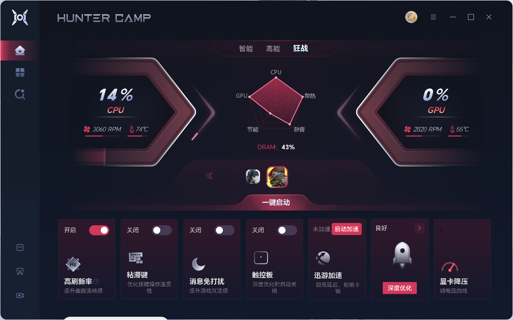
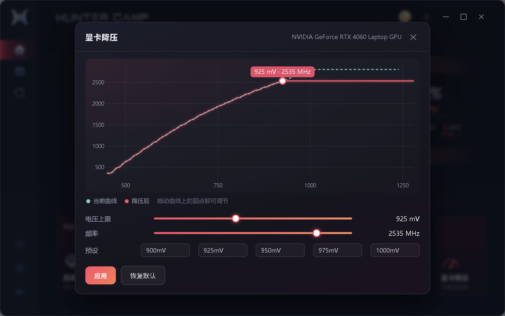

# HUNTER CAMP 改动集（荣耀猎人营地 小修小补）

> 📦 免编译安装包见 [Releases](https://github.com/OolongBlackCoffee/huntercamp-tweaks/releases)：下载 `huntercamp-tweaks.zip` 与 `HcGpuSvc.zip`，把 `HcGpuSvc.exe` 放进 `payload\`，然后双击 `一键部署.bat`。

给荣耀 **HUNTER CAMP（猎人营地）** 桌面端加几样官方没给的功能，并附一套**升级覆盖后一键恢复**的部署脚本。

> 纯本地、纯前端注入 + 一个本地小服务，不改官方安装包、不联网、不收集任何数据。
> 实测环境：HONOR MagicBook Pro 16（Core Ultra 7 155H + RTX 4060 Laptop，驱动 621.01），Windows 11，HUNTER CAMP 1.0.0.34。

---

---

## 预览

| 改后的首页（多出「触控板」「显卡降压」两张卡） | 显卡降压面板 |
| --- | --- |
|  |  |

> 对比：官方原版首页（逗逗卡片 + 只有 6 张卡）见 `docs/images/home-original.png`

---
## 一、都改了什么

| # | 功能 | 说明 |
|---|---|---|
| 1 | **首页「触控板」开关卡** | 首页底栏那张「逗逗陪玩」卡原地改成触控板开关：点卡片 = 开关 Windows 精密触控板；按下「深度优化」时自动关闭且**保持关闭**（不自动恢复，要不要开由你点） |
| 2 | **显卡降压（VF 曲线编辑器）** | 首页新增第 7 张卡「显卡降压」：拖曲线 / 滑杆选「电压上限 + 频率」，一键把 VF 曲线在设定点之后压平，等效微星小飞机的降压。按「深度优化」时自动套用，结束后不恢复 |
| 3 | **解除 GPU 超频上限** | 官方把核心超频限制在 200 MHz、显存限制在 400 MHz，本改动各放大 3 倍 → **600 / 1200**（含输入框提示、滑杆刻度、取整裁剪一起改） |
| 4 | **彻底送走「逗逗陪玩」** | 侧栏入口、跳转路由、配置、48 MB Web 前端、15.5 MB 主程序、91.8 MB WebView2 缓存全部隔离（保留 3 个 570 KB 的 DLL，删了会让主程序每 9 秒崩一次，原因见 `docs/逗逗移除-详情.md`） |

一句话：**首页多两个能用的开关，超频上限放开，逗逗不再来。**

---

## 二、快速开始

前置：Windows 11 + 已安装 HUNTER CAMP + 管理员权限（脚本会自己弹 UAC）。

```text
1. 下载本仓库（Code → Download ZIP，或 git clone）
2. 按第四节把「显卡降频服务」编译出来放进 payload\（只用功能 1/3/4 可以跳过）
3. 双击「一键部署.bat」→ UAC 点「是」→ 等 20 秒
4. 应用会自动重启，首页就能看到改动
```

想彻底回官方原状：双击 **「还原.bat」**。

| 场景 | 操作 |
| --- | --- |
| 猎人营地升级了 / 被覆盖安装，卡片不见了 | 双击 **一键部署.bat** |
| 只重装降频服务、不重启应用 | `powershell -File deploy.ps1 -SkipAppRestart` |
| 不想看控制台 | 加 `-Quiet`，结果写 `deploy-last.log` |
| 全部还原 | 双击 **还原.bat**（等价 `deploy.ps1 -Restore`） |

---

## 三、目录结构

```text
huntercamp-tweaks/
├─ 一键部署.bat          部署入口（GBK 编码，双击即可）
├─ 还原.bat              还原入口
├─ deploy.ps1            主脚本：提权 → 注入 → 改配置 → 装服务 → 重启
├─ payload/
│  ├─ huntercamp-homecard.js   首页触控板卡（替换逗逗卡 + 深度优化联动）
│  ├─ huntercamp-uv.js         显卡降压卡片与曲线面板
│  ├─ huntercamp-nodoudou.js   逗逗入口兜底隐藏
│  ├─ patch-oclimit.js         改 chunk 里的超频上限（Node，幂等）
│  └─ HcGpuSvc.exe            ← 需自行编译，见第四节
├─ gpusvc/               显卡降频服务源码（C# / .NET 10）
│  ├─ Program.cs
│  └─ HcGpuSvc.csproj
└─ docs/
   ├─ 逗逗移除-详情.md    崩溃堆栈分析、隔离清单
   └─ 显卡降压.md         NVAPI 函数 ID、结构体布局、命令行用法
```

---

## 四、显卡降频服务（功能 2 的后端）

前端只能写 UI，真正改 VF 曲线要靠 NVAPI 私有接口 —— 所以有一个本地服务：

- 程序：`C:\ProgramData\HunterCamp-GpuSvc\HcGpuSvc.exe`
- 计划任务：`HunterCamp-GpuSvc`（SYSTEM / 开机自启 / 最高权限，因为写 NVAPI 需要管理员）
- 端口：`127.0.0.1:8977`，日志 `C:\ProgramData\HunterCamp-GpuSvc\svc.log`

**编译**（需要 .NET SDK 8+，实测 .NET 10）：

```powershell
cd gpusvc
dotnet publish -c Release -r win-x64 --self-contained true -p:PublishSingleFile=true -p:IncludeNativeLibrariesForSelfExtract=true -o out
copy out\HcGpuSvc.exe ..\payload\HcGpuSvc.exe
```

没有这个 exe 也能部署：脚本会提示「payload 里没有 HcGpuSvc.exe，跳过降频服务」，其余三项照常生效（降压卡片会显示但点开会连不上服务）。

命令行也能直接用（管理员权限）：

```powershell
HcGpuSvc.exe --once curve                       # 打印当前 127 个电压点
HcGpuSvc.exe --once apply --mv 925 --mhz 2580   # 把 925mV 之后压平到 2580MHz
HcGpuSvc.exe --once offset --khz 150000         # 整体 +150MHz（恢复原厂超频值）
HcGpuSvc.exe --once clear                       # 清空所有偏移
```

---

## 五、原理速览

- **注入方式**：改 `build\index.html`，带版本号（`?v=时间戳`）插入三个脚本 —— WebView2 会缓存静态 js，不加版本号改了也不生效。
- **桥接**：前端用官方现成的 `window.pcHonorBridge.actionBusiness(base64(JSON({msgID,status,code,pageID,data})))` 给主进程发消息，回调走 `window.webviewBusinessMessage`（应用重新赋值时要重新包装）。
- **触控板**：消息 `TouchpadGet / TouchpadSet`；真实状态看 `HKCU\Software\Microsoft\Windows\CurrentVersion\PrecisionTouchPad\Status\Enabled`。
- **深度优化联动**：包 `window.btoa`，一旦发出的 base64 里出现 `msgID: StartDeep` 就执行联动。**只认 15 秒内真实点击过按钮的那次**，否则应用启动时自动跑的那轮也会触发（会每开机关一次触控板）。
- **超频上限**：改的是前端 chunk 里的限值字面量，只动 UI，不碰写驱动链路。
- **卡片行排布**：原来 6 张卡，加第 7 张会溢出，脚本把宽度压到 `1.05rem` 并收窄间距。

更多细节：`docs/显卡降压.md`（NVAPI 私有函数 ID、结构体偏移）、`docs/逗逗移除-详情.md`（为什么 DLL 不能删）。

---

## 六、软件升级后会怎样

官方覆盖安装会把 `build\` 整个覆盖掉，于是：

- `index.html` 变回原版 → 注入脚本不再加载；
- `build\static\js\huntercamp-*.js` 被删除；
- 超频上限回到 200 / 400；
- `Xml\HunterCampDoudou.xml` 回到 `Open="1"`；
- 逗逗的大件如果升级包里有，会重新出现。

**双击「一键部署.bat」即可全部恢复**（含服务与计划任务），这就是这套脚本存在的意义。

---

## 七、FAQ

**Q：界面没出现 / 按什么都没反应？**
A：应用窗口被它自己藏起来了，按 `Win+Shift+G` 呼出。

**Q：装完首页还是老样子？**
A：多半是 WebView2 缓存。重新跑一次 `一键部署.bat`（会带新版本号），或在应用里按 `Ctrl+F5` 前先退出应用再开。

**Q：触控板卡片显示的开关和实际不一致？**
A：卡片显示的是应用自己上报的状态，实际状态看注册表。点一下卡片就会同步。

**Q：降压/超频填大数值没事吗？**
A：上限只是放开了 UI 限制，能不能稳住取决于显卡体质。建议核心 **+300**、显存 **+600** 起步，用 3DMark 或实际游戏测，出现花屏 / 驱动重启就回退。出问题用 `HcGpuSvc.exe --once clear` 或面板的「恢复默认」。

**Q：会不会被官方检测/封号？**
A：这是纯本地 UI 层改动，不涉及账号、不联网、不改游戏进程。但**任何第三方修改都有风险**，自行判断。

---

## 八、免责声明

本项目仅供学习与个人使用，与荣耀（HONOR）官方无关。修改系统级设置（触控板、显卡电压/频率、计划任务）有风险，请自行备份、自负后果。动手前建议先建一个系统还原点。

---

## 九、参考

- NVAPI 私有接口 ID 与结构体布局部分参考了 [vuplea/simple-nvidia-undervolt](https://github.com/vuplea/simple-nvidia-undervolt)（MIT）。
- 主程序崩溃分析用的 Windows 事件日志 `Application / .NET Runtime / 1026`。

## License

MIT
